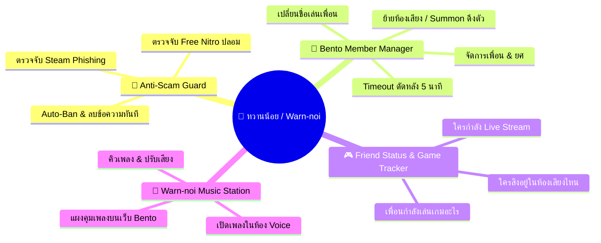

# 🎮 หวานน้อย (Warn-noi) — Roadmap & Feature Specification

เอกสารสเปกฟีเจอร์และแผนงานพัฒนาสำหรับบอทและแดชบอร์ด **หวานน้อย (Warn-noi)** 
ออกแบบมาเพื่อ **Discord แก๊งเล่นเกมและคุยเล่นกับเพื่อน (Gaming Hangout & Chill Server)** 
ชื่อ "หวานน้อย" (กวนๆ น่ารัก เป็นมิตร) ควบคู่กับคำว่า "Warn-noi" (เน้นเตือนเบาๆ ดักสแกมเมอร์ ปิดไมค์เพื่อน แกล้งเพื่อนพอหอมปากหอมคอ)
และดีไซน์หน้าเว็บสไตล์ **Minimalist Black & White Bento Grid**

---

## 🎨 แนวทางการออกแบบ UI/UX: Black & White Bento Grid Style

- **โทนสี (Palette)**: ขาว-ดำ-เทา (Monochrome / Grayscale) 
  - พื้นหลังหลัก: ดำสนิท Deep OLED Black (`#09090b` / `#000000`) พร้อม Ambient Dot Matrix
  - กล่อง Bento Card: เทาเข้มคลาสสิก (`rgba(18, 18, 20, 0.75)`) ตัดขอบเส้นบางเฉียบ Subtle Inset Glow (`inset 0 1px 0 0 rgba(255,255,255,0.09)`)
  - ตัวหนังสือ & ไอคอน: ขาวสว่าง (`#ffffff`) และเทากลางเน้นอ่านสบายตา (`#a1a1aa`)
  - ปุ่มไฮไลท์: Inverted White Button (ขาวทึบตัวหนังสือดำ) และ Ghost Buttons
- **เลย์เอาต์ (Bento Layout)**: จัดการแดชบอร์ดเป็นกล่องตารางสี่เหลี่ยมหลายขนาด (12-col grid) วางเรียงต่อกันอย่างเป็นระเบียบคล้ายกล่องเบนโตะแบบ Apple & Linear App

---

## 📌 สรุปฟีเจอร์หลัก (Core Features of Warn-noi)

---

## 🚀 รายละเอียดฟีเจอร์ตามหมวดหมู่ (Feature Specifications)

### 1. 🛑 ระบบดักสแกมเมอร์ & แบนอัตโนมัติ (Anti-Scam & Spambot Defense)
*ปกป้องห้องดิสไม่ให้เพื่อนโดนหลอกกดลิงก์ดูดรหัส หรือบอทแปลกหน้าเข้ามาสแปม*

- **ตรวจจับข้อความสแกมยอดฮิต**:
  - ลิงก์หลอกแจก Nitro ฟรี เช่น `dlscord-nitro.com`, `discorcl-free.click`, `free-nitro`
  - ลิงก์สตีมปลอมหลอกให้โหวตทีมแข่ง หรือรับสกิน CS2 / Dota เช่น `steamcommyunlty.com`
  - ข้อความสแปมบอท Crypto, Forex, แทงบอล
- **Action อัตโนมัติ**:
  - ลบข้อความทิ้งในเสี้ยววินาที (< 0.1s)
  - แบน (Ban) หรือเตะ (Kick) สแกมเมอร์ออกจากเซิร์ฟเวอร์ทันที
  - ส่งแจ้งเตือนลงห้อง `#mod-logs` พร้อมหลักฐานข้อความและ IP/ID ของสแกมเมอร์

---

### 2. 👥 Bento Member Manager (หน้าต่างจัดการสมาชิก & แก๊งเพื่อน)
*จัดการเพื่อนในดิสง่ายๆ สไตล์ Bento Card กดคลิกเดียวจบไม่ต้องเข้าเมนูลึกๆ ของ Discord*

- **หน้าต่างสมาชิกแบบ Bento Cards**:
  - แสดงการ์ดเพื่อนแต่ละคน พร้อม Avatar, สถานะเสียง, และยศปัจจุบัน
- **Quick Mod Actions (ปุ่มด่วน)**:
  - 🔇 **Mute / Deafen**: ปิดไมค์/ปิดหูเพื่อนชั่วคราว
  - ✈️ **Move Voice**: โยกเพื่อนคนนั้นมาที่ห้องเสียงที่เรากำลังอยู่ทันที (Summon)
  - ⏱️ **Timeout**: สั่ง Timeout ดัดหลังเพื่อนที่เปิดไมค์ช็อตหรือกวนประสาท (1 นาที / 5 นาที)
  - 🏷️ **Edit Nickname**: เปลี่ยนชื่อเล่นในเซิร์ฟเวอร์ได้ทันทีจากหน้าเว็บ
  - 👑 **Assign Role**: คลิกเพิ่ม/ถอดยศให้เพื่อนได้ทันที

---

### 3. 🎮 Status Server & Member Activity (ส่องเพื่อน & สเตตัสเซิร์ฟเวอร์)
*แผง Bento สดสำหรับส่องเพื่อนว่าใครกำลังทำอะไรอยู่*

- **Game Activity Tracker**:
  - แสดงว่าตอนนี้เพื่อนในแก๊งกำลังเล่นเกมอะไรอยู่ (เช่น `Playing VALORANT`, `Dota 2`, `Apex Legends`)
  - แสดงระยะเวลาที่เล่นไปแล้ว เช่น "เล่นมาแล้ว 2 ชม. 45 นาที"
- **Voice Room Live Radar**:
  - แผนผังกล่อง Bento แสดงว่าใครคุยกันอยู่ในห้องเสียงไหนบ้าง
  - ใครกำลังเปิดไมค์พูดอยู่ (Green voice indicator), ใครปิดไมค์ (Muted)
  - ใครกำลังแชร์หน้าจอ / ถ่ายทอดสดเกม (Screen Sharing / Streaming)

---

### 4. 🎵 Warn-noi Music Station (เปิดเพลงในห้องเสียง + แผงคุมบนเว็บ)
*เปิดเพลงฟังพร้อมเพื่อนตอนเล่นเกม คุมง่ายจากหน้าเว็บ Bento จอที่สอง*

- **Voice Channel Connection**:
  - บอทจอยห้องเสียงตามคำสั่งในดิสคอร์ด (`/play <ชื่อเพลง/ลิงก์>`) หรือกดสั่งจอยจากหน้าเว็บ
- **Web Bento Player Interface (คุมเพลงบนเว็บ)**:
  - 🎛️ **Now Playing Widget**: แสดงภาพปกเพลง, ชื่อเพลง, ศิลปิน, แถบเวลา Progress Bar
  - ⏯️ **Playback Controls**: ปุ่ม Play, Pause, Skip, Replay, Stop
  - 🔊 **Volume Slider**: ปรับระดับเสียงบอทให้เข้ากับจังหวะเล่นเกม
  - 📜 **Queue Manager**: รายการเพลงในคิว เลื่อนสลับคิวได้ หรือกดลบเพลงที่ไม่ชอบออกจากคิว

